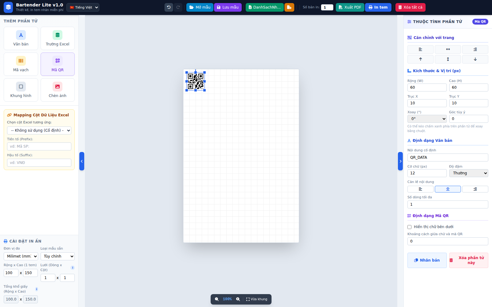

<p align="center"></p>

<h1 align="center">Bartender Lite</h1>
<p align="center">Ứng dụng thiết kế và in tem nhãn miễn phí · Free label designer &amp; printer</p>



## Giới thiệu
**Bartender Lite** giúp bạn tự thiết kế và in tem nhãn (mã vạch, mã QR, thông tin sản phẩm...) ngay trên máy tính, in trực tiếp ra máy in tem (như TSC) hoặc máy in bất kỳ, hoặc xuất PDF đúng kích thước.

## Tính năng
- Thiết kế tem tự do: văn bản, trường dữ liệu Excel, mã vạch, mã QR, khung hình, ảnh/logo.
- Nạp dữ liệu Excel/CSV (`.xls`, `.xlsx`, `.csv`), mapping cột vào từng phần tử, in hàng loạt (mail-merge).
- Xem trước từng dòng dữ liệu và chọn phạm vi in (tất cả / dòng đầu / tùy chọn).
- Tự tính khổ giấy từ kích thước tem và lưới (hàng x cột).
- Tự xuống dòng, cắt chữ khi vượt khung; kéo, xoay, đổi cỡ, nhân bản phần tử; Undo/Redo.
- Lưu/mở mẫu tem (`.json`), nhấp đúp file mẫu để mở trực tiếp trong app.
- In trực tiếp (chọn máy in) hoặc xuất PDF đúng kích thước thiết kế.
- Giao diện 5 ngôn ngữ: Tiếng Việt, English, 简体中文, 한국어, 日本語.

## Tải về
Tải bản cài mới nhất ở trang [**Releases**](../../releases/latest). Mỗi lần build tự động có tag `v<phiên bản>-build<số>` (ví dụ `v1.0.0-build42`):

| Hệ điều hành | File |
|---|---|
| Windows 64-bit | `Bartender-Lite-1.0.0-build<N>-Setup.exe` |
| macOS chip Apple (M1 trở lên) | `Bartender-Lite-1.0.0-build<N>-macOS-AppleSilicon.pkg` |
| macOS chip Intel | `Bartender-Lite-1.0.0-build<N>-macOS-Intel.pkg` |
| Linux Mint / Ubuntu / Debian 64-bit | `bartender-lite_1.0.0-build<N>_amd64.deb` |

### Cài đặt
- **Windows:** chạy file `.exe`. Nếu SmartScreen cảnh báo (app chưa ký số), chọn *More info* → *Run anyway*.
- **Linux:** `sudo apt install ./bartender-lite_1.0.0-build<N>_amd64.deb`.
- **macOS:** mở file `.pkg`; app chưa ký số nên lần đầu bấm chuột phải vào `.pkg` → *Open* (hoặc System Settings → Privacy & Security → Open Anyway).

## Hướng dẫn sử dụng
Hướng dẫn đầy đủ có hình minh họa trong thư mục [`docs/`](docs/):

| Ngôn ngữ | File |
|---|---|
| Tiếng Việt | `HuongDanSuDung_BartenderLite_VI.docx` |
| English | `UserGuide_BartenderLite_EN.docx` |
| 简体中文 | `UsageGuide_BartenderLite_ZH.docx` |
| 한국어 | `UserGuide_BartenderLite_KO.docx` |
| 日本語 | `UserGuide_BartenderLite_JA.docx` |

### Bắt đầu nhanh
1. Chọn kích thước tem và lưới (hàng x cột) ở mục **Cài đặt in ấn**. Ví dụ tem 35x22 mm, cuộn 3 tem/hàng: cột = 3.
2. Thêm phần tử (văn bản, mã vạch, mã QR, ảnh...) và kéo vào vị trí.
3. Cần dữ liệu hàng loạt: bấm **Nạp Excel**, rồi map cột vào phần tử (chọn phần tử, chọn cột ở khối Mapping).
4. Dùng **Xem trước** để kiểm tra từng dòng, chọn **Phạm vi in** và **Số bản in**.
5. Bấm **In tem**, hoặc **Xuất PDF** (khi in PDF, chọn kích thước thực tế 100%).

## Chạy và build từ mã nguồn
Yêu cầu Node.js 18+.
```bash
npm install
npx electron .                                          # chạy thử
npx electron-builder --win nsis --x64                   # Windows (cần wine nếu build trên Linux)
npx electron-builder --linux deb --x64                  # Linux
npx electron-builder --mac pkg --x64 --arm64            # macOS
```
Kết quả nằm trong `dist/`. Mỗi lần push lên `main` (trừ khi chỉ sửa `.md`/`docs/`), GitHub Actions tự build 3 hệ điều hành và tạo Release mới. Cũng có thể chạy tay ở tab **Actions** → *Build installers* → *Run workflow*.

Dọn dẹp: tab **Actions** → *Dọn Release cũ* → *Run workflow* sẽ chỉ giữ lại Release mới nhất, xoá Release cũ, tag cũ, toàn bộ Artifacts và lịch sử các lần chạy trước.

## Cấu trúc
```
app/        giao diện (index.html, một file, Tailwind tĩnh)
main.js     tiến trình chính Electron (cửa sổ, in, IPC)
preload.js  cầu nối an toàn giữa giao diện và main
build/      icon ứng dụng
docs/       hướng dẫn sử dụng 5 ngôn ngữ
.github/    workflow tự build bản cài (GitHub Actions)
```

## English summary
Bartender Lite is a free desktop label designer: drag-and-drop text, Excel fields, barcodes, QR codes, shapes and images; import Excel/CSV and map columns for bulk printing; print directly to any printer or export a PDF at the exact label size. UI in Vietnamese, English, Chinese, Korean and Japanese. Installers for Windows, Linux and macOS are on the [Releases](../../releases/latest) page; user guides in [`docs/`](docs/).

## Tác giả
ngthhung
